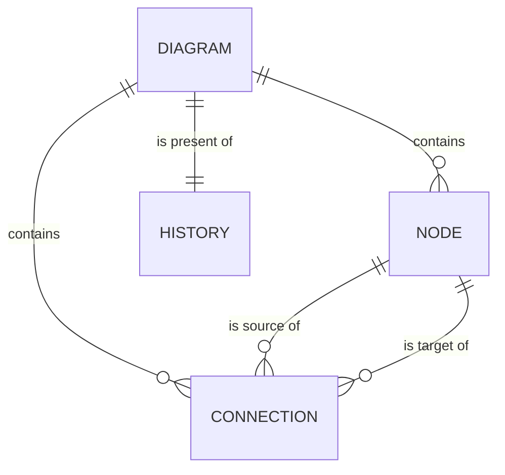

# Data Model: Flowchart Visual Editor

All types live in the model layer (layer 1) and are plain immutable data: no DOM, no Mermaid text. Names
below are the design vocabulary; the spec's entities are Diagram, Node, Connection, Generated Source, Editing
History and Feedback Message.

## Diagram

| Field | Type | Rules |
|-------|------|-------|
| `type` | `"flowchart"` | Only value in this release (FR-001). |
| `nodes` | ordered list of Node | Creation order; order never changes. |
| `connections` | ordered list of Connection | Creation order; order never changes. |
| `nextNodeNumber` | positive integer | Next creation number; only increases, never reused after delete or undo-redo. |
| `nextConnectionNumber` | positive integer | Same, for connections. |

A new diagram is `{ type: "flowchart", nodes: [], connections: [], nextNodeNumber: 1, nextConnectionNumber: 1 }`
(FR-001, FR-021).

**Invariants** (checked by validation, relied on by generation):

1. Every connection's `sourceId` and `targetId` name a node in `nodes` (self-loops allowed: both may be equal).
2. Node ids are unique; connection ids are unique.
3. Every node label has at least one visible character (FR-006).
4. No two nodes overlap by their nominal footprint (EC-06).
5. Nothing else is restricted: cycles, fan-in, fan-out, duplicate connections, opposite-direction connections
   and disconnected nodes are all valid (FR-013, EC-03).

## Node

| Field | Type | Rules |
|-------|------|-------|
| `id` | string | `node-<number>`; identity, immutable. The Mermaid id is derived as `n<number>`. |
| `shape` | ShapeKind | Fixed at creation (FR-025). |
| `label` | string | At least one visible character; may contain line breaks; no length limit. |
| `position` | `{ x, y }` | Layout only; never in the source (EC-07). |

**ShapeKind** (nine, FR-002): `rectangle`, `rounded`, `stadium`, `diamond`, `circle`, `parallelogram`,
`cylinder`, `subroutine`, `hexagon`. A default label is given at creation, for example the shape's display
name (editable).

## Connection

| Field | Type | Rules |
|-------|------|-------|
| `id` | string | `connection-<number>`; identity, immutable, so duplicates stay distinct (EC-03). |
| `sourceId` | node id | Fixed at creation (FR-009). |
| `targetId` | node id | Fixed at creation; may equal `sourceId`. |
| `style` | `"solid" \| "dotted" \| "thick"` | Fixed at creation. |
| `ends` | `"forward" \| "none" \| "both"` | Arrow at target only, plain line, arrows at both ends. Fixed at creation. |
| `label` | string | May be empty (no label in source); may be multi-line; no length limit. The only editable field. |

Nine connection types = 3 styles × 3 ends (Clarifications). For `ends: "none"` or `"both"` the pair of endpoints
is still ordered (source, target) so the source line is deterministic.

## Operation

An operation is a request to change a Diagram. The set is closed; there is deliberately no operation that
changes a node's shape or a connection's style, ends or endpoints (FR-025, FR-009).

| Kind | Payload | Notes |
|------|---------|-------|
| `addNode` | shape, requested position, default label | Position resolved to a free one before commit. |
| `moveNode` | node id, requested position | Position resolved to a free one; a result equal to the current position is not committed. |
| `renameNode` | node id, label | Rejected if the label has no visible character. |
| `deleteNode` | node id | Also removes every connection with this node as an endpoint; adds none. |
| `addConnection` | source id, target id, style, ends, label | Both endpoints must exist. |
| `editConnectionLabel` | connection id, label | Empty allowed. |
| `deleteConnection` | connection id | Removes only that connection. |

Contract details: [contracts/operations.md](contracts/operations.md).

## Rejection

| Field | Type | Rules |
|-------|------|-------|
| `reason` | enum | `unknownNode`, `unknownConnection`, `blankLabel`, `unknownEndpoint` |
| `message` | string | Plain-language sentence from the catalog; shown to the user (FR-012). |

A rejected operation returns the unchanged Diagram (same reference) and the Rejection; nothing is pushed to
history.

## History

| Field | Type | Rules |
|-------|------|-------|
| `present` | Diagram | The current diagram. |
| `past` | list of Diagram | Oldest first; one entry per committed operation. |
| `future` | list of Diagram | Cleared whenever an operation commits (FR-019). |

`canUndo` is `past` non-empty; `canRedo` is `future` non-empty (unavailable otherwise, FR-019).

**Transitions**: `commit(op)`: validate; if rejected, state unchanged; else push `present` to `past`, set
`present` to the result, clear `future`. `undo`: move `present` to `future`, take the last of `past`. `redo`:
the reverse. A position-resolving step happens before commit, so replay is exact.

## Editor state (composition layer, not in the Diagram)

| Field | Rules |
|-------|-------|
| `history` | The History above. |
| `selection` | none, a node id, or a connection id. Never part of an undo step; cleared if the selected element no longer exists. |
| `feedback` | Latest Feedback Message: `kind` (`success`, `rejection`, `failure`), `text`, and an increasing sequence number so a repeated identical message is announced again. |
| `labelDraft` | An open label edit (target and text) or none. Becomes one operation on confirm; discarded on cancel. |
| `sourceStatus` | `checking`, `valid` or `failed(reason)` for the newest generated source (research R8). |
| `sourcePanelOpen` | Boolean, default `false`. |

## Generated Source

Not stored. `generate(diagram) -> string` is a pure function. Rules and exact syntax:
[contracts/mermaid-output.md](contracts/mermaid-output.md).

## Relationships

Deleting a node removes the connections on both of its sides in the same operation; nothing is ever created.
